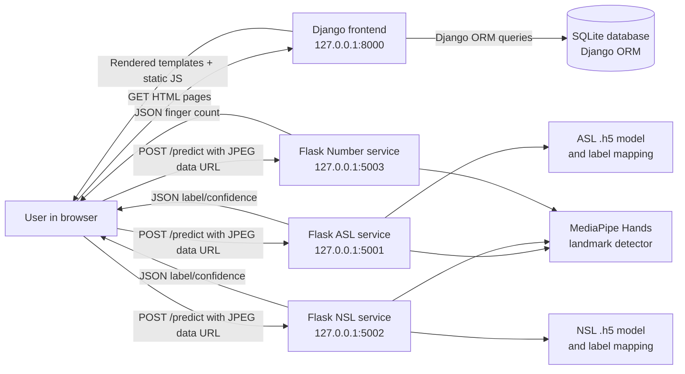
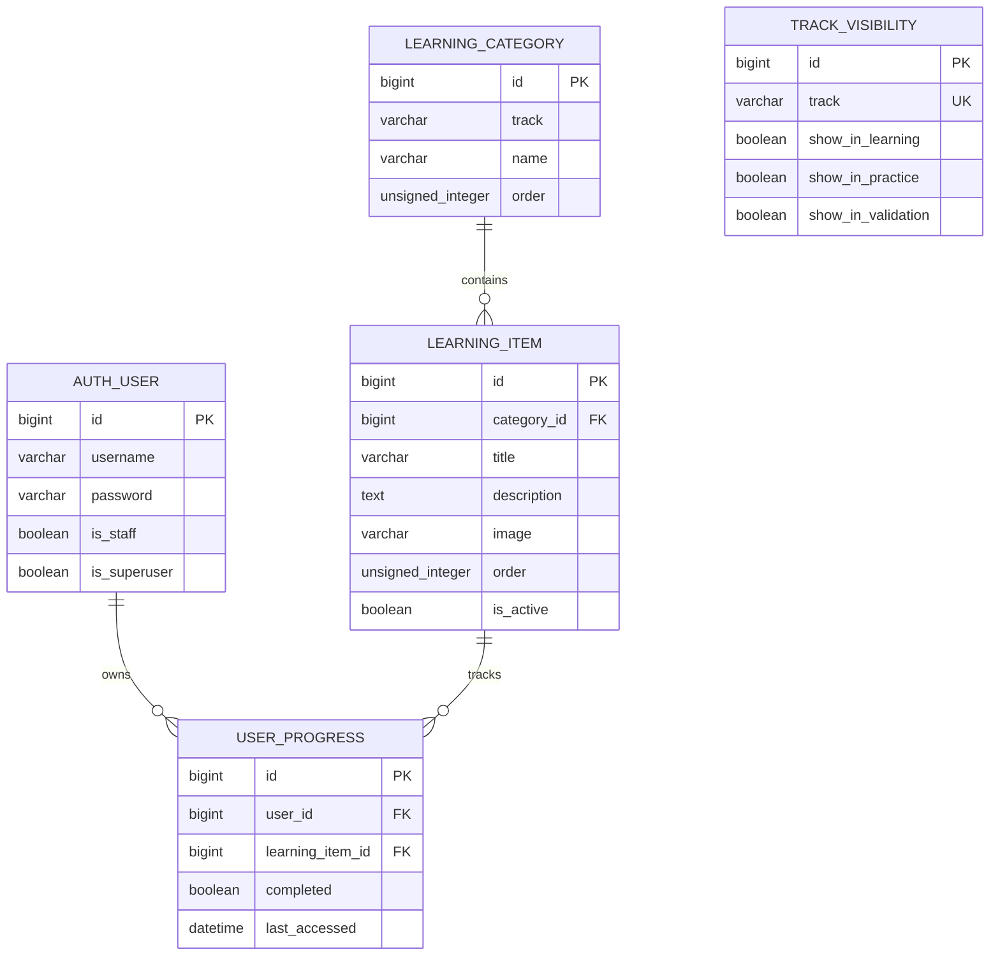
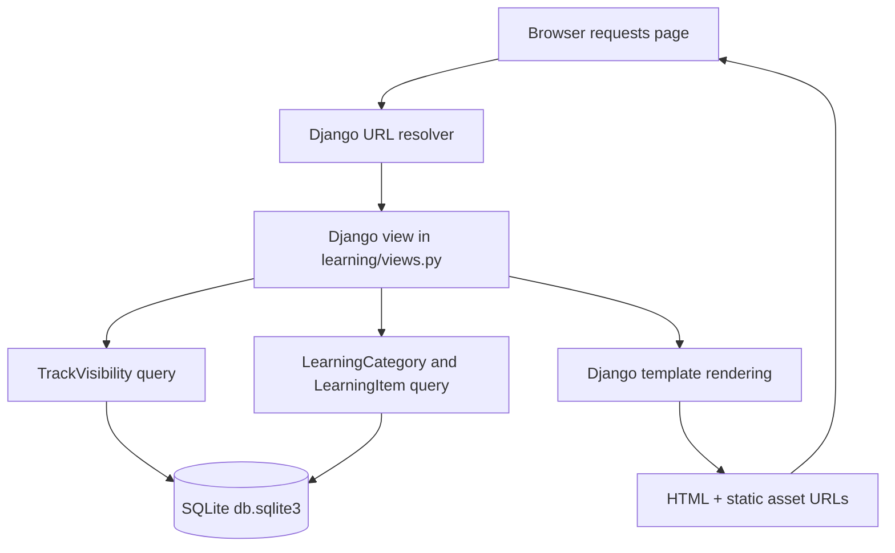
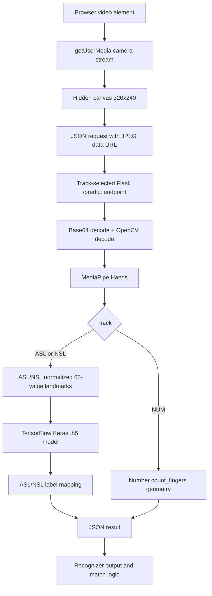
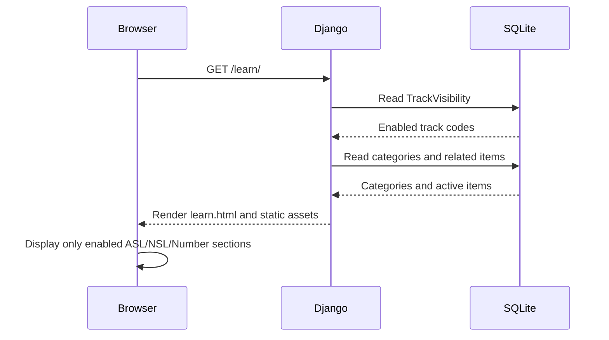
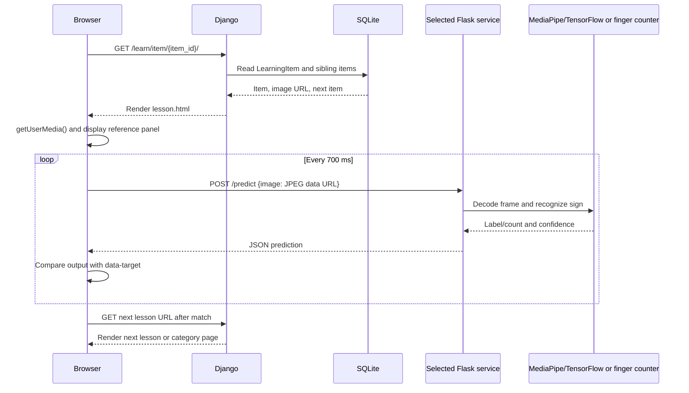
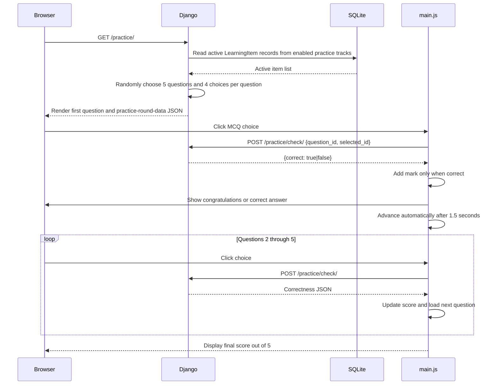
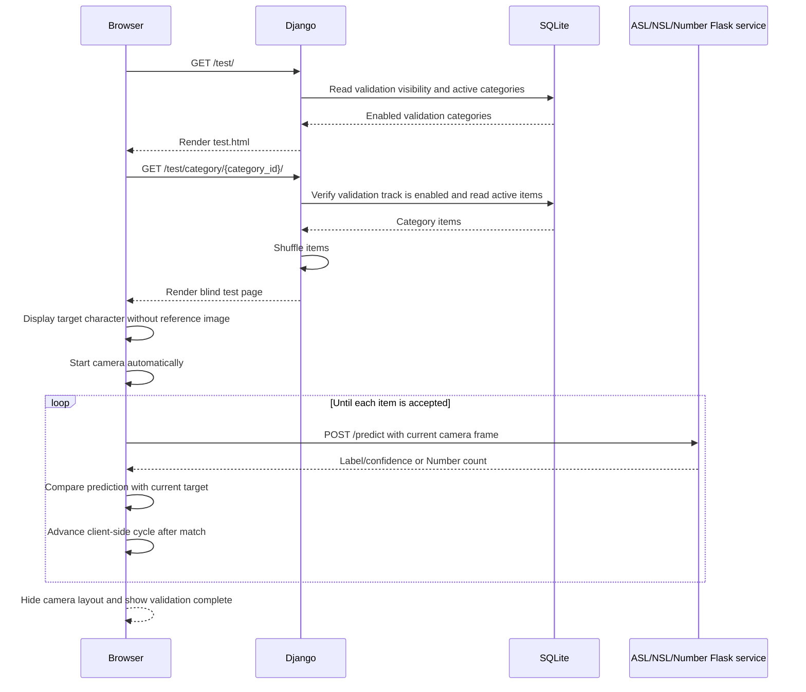
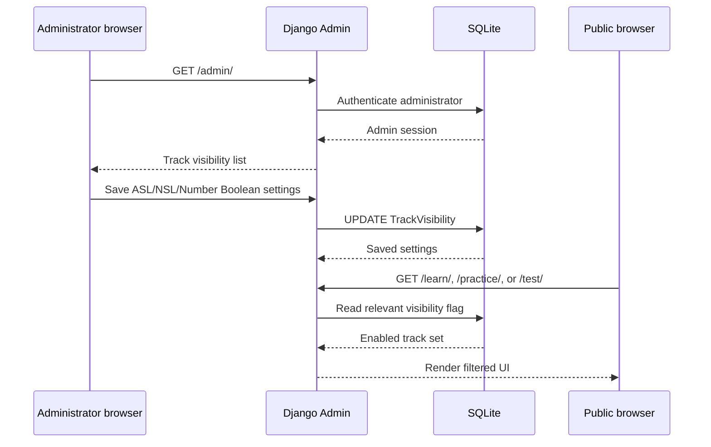

# 1. System Architecture

## 1.1 Application boundaries

SignLearn is implemented as a two-layer web application with a browser-based client between the two server processes. The Django project provides the presentation layer, content management, database access, server-rendered HTML, Django Admin, and the public page routes. The Flask services provide recognition APIs that receive browser camera frames, execute MediaPipe preprocessing and either trained-model inference or geometric finger counting, and return JSON results.

The browser does not send camera frames to Django. The browser JavaScript calls the appropriate Flask service directly based on the track code. Django owns the learning content database; Flask does not open the SQLite database and does not query Django models. This separation is implemented in `frontend/static/js/camera-verification.js`, where `backend` is selected from the track and the request is sent to `${backend}/predict`.[1]


https://github.com/acharya-2226
## 1.2 Layer responsibilities

| Layer | Actual implementation | Primary responsibilities |
|---|---|---|
| Browser presentation | Django templates, `static/css/style.css`, `static/js/main.js`, and `static/js/camera-verification.js` | Displays learning content, requests camera permission, renders images, sends recognition frames, gives practice feedback, advances validation cycles, and displays scores. |
| Django application | `frontend/signlearn`, `frontend/learning`, and `frontend/templates` | Serves HTML, reads and writes the SQLite database through Django ORM, exposes content routes, applies track visibility settings, provides Django Admin, and serves media during development. |
| Flask recognition layer | `backend/app_webcam_asl.py`, `backend/app_webcam.py`, and `backend/app_webcam_number.py` | Decodes browser JPEG data URLs, detects hand landmarks, runs ASL/NSL model inference or Number finger counting, and returns JSON. |
| Model and asset layer | `.h5` files, label mapping text files, MediaPipe, OpenCV, and NumPy | Provides trained classification assets for ASL/NSL and landmark geometry for all tracks. |

## 1.3 Communication and authentication

The browser communicates with Django over HTTP on port `8000` and communicates with Flask over HTTP on ports `5001`, `5002`, and `5003`. Flask CORS is enabled globally with `CORS(app)` in all three services, so browser requests from the Django development origin are permitted.[2] [3] [4]

The current public application has no custom learner authentication flow. The public account routes were removed from `frontend/learning/urls.py`, and the public views do not use `login_required`. Django Admin remains available at `/admin/` and uses Django’s built-in authentication system. The current database and initial migration still contain the `UserProgress` model and the built-in Django auth dependency even though the current public views no longer use learner progress.[5] [6] [7]

The Flask APIs do not implement authentication, authorization, API keys, sessions, or tokens. Their request contract is therefore suitable for local development but requires additional security controls before exposure outside a trusted local machine. **[NEEDS INPUT] Production authentication, TLS, allowed origins, reverse-proxy policy, and deployment security requirements are not defined in the current codebase.**

# 2. Technology Stack

## 2.1 Frontend stack

The frontend dependency file specifies Django and Pillow as follows:[8]

```text
Django>=5.0,<7.0
Pillow>=10.0
```

The project was generated with Django `6.1`, as stated in `signlearn/settings.py` and the migration headers. The dependency range permits other Django 5.x and 6.x releases, but the source archive does not pin one exact Django version. The documented observed project version is therefore Django `6.1`; the install contract is `Django>=5.0,<7.0`.[9]

| Component | Version or constraint | Usage in source |
|---|---|---|
| Django | `>=5.0,<7.0`; project files identify Django `6.1` | Routing, templates, ORM, Admin, migrations, static/media serving, WSGI, and ASGI. |
| Pillow | `>=10.0` | Required by Django `ImageField` for learning sign images. |
| SQLite | SQLite database configured in `signlearn/settings.py` | Local relational database accessed through Django ORM. |
| HTML/CSS | Server-rendered Django templates and `static/css/style.css` | User interface. |
| Browser JavaScript | `static/js/main.js` and `static/js/camera-verification.js` | MCQ interaction, mobile navigation, camera access, Flask API calls, and validation state. |
| Media storage | `MEDIA_ROOT = BASE_DIR / 'media'` and `MEDIA_URL = 'media/'` | Learning images. During `DEBUG=True`, `signlearn/urls.py` serves media through Django’s development helper. |

## 2.2 Backend stack

The Flask dependency file pins the recognition-service stack:[10]

```text
Flask==3.1.1
flask-cors==6.0.1
mediapipe==0.10.21
numpy==1.26.4
opencv-contrib-python==4.11.0.86
protobuf==4.25.9
tensorflow==2.15.1
```

| Package | Version | Role |
|---|---:|---|
| Flask | `3.1.1` | HTTP application framework and route decorators such as `@app.get` and `@app.post`. |
| flask-cors | `6.0.1` | Enables CORS with `CORS(app)`. |
| MediaPipe | `0.10.21` | Provides `mp.solutions.hands`, hand landmark detection, handedness, and landmark drawing. |
| NumPy | `1.26.4` | Converts decoded images and landmarks into arrays and prepares the `(1, 63, 1)` model input. |
| OpenCV | `opencv-contrib-python==4.11.0.86` | Decodes Base64 JPEG payloads, converts color spaces, encodes annotated frames, and performs image operations. |
| protobuf | `4.25.9` | Compatibility dependency for the pinned MediaPipe/TensorFlow combination. |
| TensorFlow | `2.15.1` | Loads and executes the ASL and NSL Keras `.h5` classifiers. |
| Python `pathlib` and `os` | Standard library | Resolves model paths and reads environment variables. |
| Python `base64` | Standard library | Decodes incoming data URLs and encodes annotated frames. |

## 2.3 Version compatibility

The services depend on the legacy MediaPipe API `mp.solutions.hands`. The pinned combination of MediaPipe `0.10.21`, NumPy `1.26.4`, protobuf `4.25.9`, OpenCV `4.11.0.86`, and TensorFlow `2.15.1` is documented in `backend/README.md` as the intended compatibility set.[11] **[NEEDS INPUT] The source archive does not contain a lock file with resolved transitive dependency versions.**

# 3. Database Design

## 3.1 Database configuration

The Django project uses SQLite through Django’s default ORM configuration:[9]

```python
DATABASES = {
    'default': {
        'ENGINE': 'django.db.backends.sqlite3',
        'NAME': BASE_DIR / 'db.sqlite3',
    }
}
```

The database file in the current frontend project is `frontend/db.sqlite3`. Django migration `0001_initial.py` creates `LearningCategory`, `LearningItem`, and `UserProgress`. Migration `0002_trackvisibility.py` creates `TrackVisibility`. Migration `0003_seed_track_visibility.py` inserts default visibility rows for `NUM`, `ASL`, and `NSL`.[6] [12] [13] [14]

## 3.2 Entity relationship diagram



The `AUTH_USER` entity is Django’s built-in auth table rather than a model declared in the `learning` application. Its exact full schema is provided by Django’s installed `django.contrib.auth` migrations and is not redeclared in the SignLearn source.

## 3.3 Application models

### `TRACK_CHOICES`

`learning/models.py` defines the canonical track codes:[6]

```python
TRACK_CHOICES = [
    ("NUM", "Number"),
    ("ASL", "ASL"),
    ("NSL", "NSL"),
]
```

| Code | Display label | Recognition service |
|---|---|---|
| `NUM` | Number | `app_webcam_number.py`, port `5003` |
| `ASL` | ASL | `app_webcam_asl.py`, port `5001` |
| `NSL` | NSL | `app_webcam.py`, port `5002` |

### `TrackVisibility`

| Field | Django definition | Database behavior |
|---|---|---|
| `id` | Automatically generated `BigAutoField` | Primary key. |
| `track` | `CharField(max_length=3, choices=TRACK_CHOICES, unique=True)` | One row per top-level track. Values are `NUM`, `ASL`, and `NSL`. |
| `show_in_learning` | `BooleanField(default=True)` | Controls presence in Home/Learn and direct learning routes. |
| `show_in_practice` | `BooleanField(default=True)` | Controls whether the track’s active signs enter the five-question practice pool. |
| `show_in_validation` | `BooleanField(default=True)` | Controls category visibility and direct test-category access. |

The Admin class `TrackVisibilityAdmin` displays the three Boolean fields as editable columns. The migration data function creates all three rows with all flags enabled by default.[13] [15]

### `LearningCategory`

| Field | Django definition | Database behavior |
|---|---|---|
| `id` | Automatically generated `BigAutoField` | Primary key. |
| `track` | `CharField(max_length=3, choices=TRACK_CHOICES)` | Associates the category with ASL, NSL, or Number. |
| `name` | `CharField(max_length=100)` | Category label, such as a seeded range. |
| `order` | `PositiveIntegerField(default=0)` | Ordering value. Model ordering is `track`, then `order`. |

`LearningCategory` has no direct foreign key to `TrackVisibility`. The relationship is logical through the shared `track` code. Views call `_enabled_tracks()` and compare `category.track` with the enabled code set.[6] [7]

### `LearningItem`

| Field | Django definition | Database behavior |
|---|---|---|
| `id` | Automatically generated `BigAutoField` | Primary key. |
| `category` | `ForeignKey(LearningCategory, on_delete=models.CASCADE, related_name="items")` | Every item belongs to one category; deleting the category cascades to its items. |
| `title` | `CharField(max_length=100)` | Displayed sign label, such as an ASL letter, NSL character, or number. |
| `description` | `TextField(blank=True)` | Optional lesson/practice description. |
| `image` | `ImageField(upload_to="signs/", blank=True, null=True)` | Optional reference image. |
| `order` | `PositiveIntegerField(default=0)` | Ordering within the category. |
| `is_active` | `BooleanField(default=True)` | Controls whether the item is included in learning, practice, or validation queries. |

### `UserProgress`

The model is still present in the current source and initial migration:[6] [12]

```python
class UserProgress(models.Model):
    user = models.ForeignKey(User, on_delete=models.CASCADE, related_name="progress")
    learning_item = models.ForeignKey(LearningItem, on_delete=models.CASCADE)
    completed = models.BooleanField(default=False)
    last_accessed = models.DateTimeField(auto_now=True)
```

Current public views do not query or write this model, and current Admin registration exposes `TrackVisibility`, `LearningCategory`, and `LearningItem` rather than `UserProgress`. **[NEEDS INPUT] If the final product must physically remove the `UserProgress` table and Django auth dependency, a new migration and a final cleanup pass are still required; the current archive has not removed the model from `models.py` or `0001_initial.py`.**

## 3.4 Track visibility logic

The application loads all visibility records into a dictionary keyed by track code:

```python
def _visibility_map():
    settings = TrackVisibility.objects.in_bulk(field_name="track")
    return {
        code: settings.get(code)
        for code, _label in TRACK_CHOICES
    }


def _enabled_tracks(flag_name):
    visibility = _visibility_map()
    return {
        code for code, _label in TRACK_CHOICES
        if visibility[code] is None or getattr(visibility[code], flag_name)
    }
```

A missing visibility row is treated as enabled. This provides backward compatibility for databases that have the `TrackVisibility` table but do not yet contain all three seed rows.

# 4. API Documentation

The Flask layer exposes the same two endpoint paths in each of the three independent services. The host and port identify the track.

## 4.1 Service registry

| Service file | Track returned by `/health` | Default port | Model assets |
|---|---|---:|---|
| `backend/app_webcam_asl.py` | `ASL` | `5001` | `asl_cnn_model.h5`, `asl_label_mapping_new.txt` |
| `backend/app_webcam.py` | `NSL` | `5002` | `nsl_cnn_model_new.h5`, `nsl_label_mapping_new.txt` |
| `backend/app_webcam_number.py` | `NUM` | `5003` | No `.h5` model or label mapping. |

## 4.2 `GET /health`

### ASL

```python
@app.get("/health")
def health():
    return jsonify({"ok": True, "track": "ASL", "model_available": model is not None})
```

### NSL

```python
@app.get("/health")
def health():
    return jsonify({"ok": True, "track": "NSL", "model_available": model is not None})
```

### Number

```python
@app.get("/health")
def health():
    return jsonify({"ok": True, "track": "NUM", "model_available": True})
```

| Service | URL | Success response | Status | Auth |
|---|---|---|---:|---|
| ASL | `http://127.0.0.1:5001/health` | `{"ok": true, "track": "ASL", "model_available": true|false}` | `200` | None. |
| NSL | `http://127.0.0.1:5002/health` | `{"ok": true, "track": "NSL", "model_available": true|false}` | `200` | None. |
| Number | `http://127.0.0.1:5003/health` | `{"ok": true, "track": "NUM", "model_available": true}` | `200` | None. |

`model_available` is based on whether the ASL/NSL model loaded at module initialization. It does not independently verify the mapping file or perform a prediction.

## 4.3 `POST /predict`

### Common request contract

Each service reads JSON using `request.get_json(silent=True) or {}` and requires a non-empty `image` property. The browser sends a JPEG data URL created by `canvas.toDataURL('image/jpeg', 0.72)`.[1]

```json
{
  "image": "data:image/jpeg;base64,..."
}
```

There are no query parameters, authentication headers, or user identifiers.

### Common HTTP outcomes

| Condition | Response | Status |
|---|---|---:|
| Missing or empty `image` | `{"error": "image is required"}` | `400` |
| Frame decoding, MediaPipe, TensorFlow, or other processing exception | `{"error": "<exception text>"}` | `422` |
| Successful processing | Track-specific JSON result | `200` |
| Unsupported HTTP method | Flask-generated method error | **[NEEDS INPUT] Exact response body depends on Flask’s default error handling and is not customized.** |

The common route pattern is implemented as follows in the ASL service and equivalently in the NSL and Number services:

```python
@app.post("/predict")
def predict():
    payload = request.get_json(silent=True) or {}
    if not payload.get("image"):
        return jsonify({"error": "image is required"}), 400
    try:
        return jsonify(predict_frame(decode_frame(payload["image"])))
    except Exception as exc:
        return jsonify({"error": str(exc)}), 422
```

### ASL response

For a frame without a decoded image or without a detected hand, the ASL response contains no label. For a detected hand and loaded model, it returns the mapped label and confidence:

```json
{
  "label": "A",
  "confidence": 0.93,
  "hand_detected": true,
  "available": true,
  "accepted": true,
  "annotated_image": "data:image/jpeg;base64,..."
}
```

Actual response fields from `app_webcam_asl.py` are:

| Field | Type | Meaning |
|---|---|---|
| `label` | string or null | Mapping-file label for the highest-probability class, or null when no prediction is available. |
| `confidence` | number | Maximum model probability, or `0`. |
| `hand_detected` | boolean | Whether MediaPipe found at least one hand. |
| `available` | boolean | Whether the model object is loaded. Some no-hand responses omit this field in the early-return branch. |
| `accepted` | boolean | Whether confidence is at least `CONFIDENCE_THRESHOLD`; returned for successful model predictions. |
| `annotated_image` | string or omitted | JPEG data URL containing MediaPipe landmarks when applicable. |

### NSL response

The NSL response uses the same general shape as ASL, except the source code does not return an `annotated_image` and does not return `accepted` on the prediction branch. A successful model prediction has the form:

```json
{
  "label": "क",
  "confidence": 0.91,
  "hand_detected": true,
  "available": true,
  "accepted": true
}
```

The NSL `label` is produced by `folder_to_nepali_map`, which is loaded from the mapping file and translated through `NEPALI_CHARACTERS` when the mapping value is an integer folder index.

### Number response

The Number service does not use a trained classifier. Its successful response has the form:

```json
{
  "count": 3,
  "hand_detected": true,
  "annotated_image": "data:image/jpeg;base64,..."
}
```

| Field | Type | Meaning |
|---|---|---|
| `count` | integer | Sum of extended fingers across up to two detected hands. |
| `hand_detected` | boolean | Whether MediaPipe found at least one hand. |
| `annotated_image` | string or omitted | Annotated frame containing drawn landmarks when applicable. |

## 4.4 Django application routes

The Django routes are not Flask APIs, but they are part of the application’s HTTP contract:[7]

| Method | URL | Name | View | Purpose |
|---|---|---|---|---|
| `GET` | `/` | `home` | `views.home` | Shows enabled learning tracks. |
| `GET` | `/learn/` | `learn` | `views.learn` | Shows enabled tracks and their categories. |
| `GET` | `/learn/category/<category_id>/` | `category_detail` | `views.category_detail` | Shows active signs in one learning category. |
| `GET` | `/learn/item/<item_id>/` | `item_detail` | `views.item_detail` | Shows one reference image and live camera panel. |
| `GET` | `/practice/` | `practice` | `views.practice` | Creates a five-question client-side practice round. |
| `POST` | `/practice/check/` | `practice_check` | `views.practice_check` | Compares submitted question and selected item IDs. |
| `GET` | `/test/` | `test_page` | `views.test_page` | Lists validation categories whose tracks are enabled. |
| `GET` | `/test/category/<category_id>/` | `test_category` | `views.test_category` | Creates a randomized blind validation cycle for one category. |
| `POST` | `/api/validate/<category_id>/` | `validate_api` | `views.validate_api` | Returns readiness metadata for an enabled validation category. |
| `GET` | `/admin/` | Built-in Admin route | `admin.site.urls` | Manages content and track visibility. |

Django’s `signlearn/urls.py` adds development-only media serving when `settings.DEBUG` is true:[16]

```python
if settings.DEBUG:
    urlpatterns += static(settings.MEDIA_URL, document_root=settings.MEDIA_ROOT)
```

# 5. Data Flow

## 5.1 Page and content data flow



## 5.2 Recognition data flow



Flask does not access SQLite in this flow. The model files, mapping text files, and MediaPipe runtime are the backend data sources. The Django database is used when the page is initially rendered and when content/visibility is administered.

## 5.3 Browser camera request format

`camera-verification.js` creates a canvas and sends the following actual request shape:[1]

```javascript
const response = await fetch(`${backend}/predict`, {
  method: 'POST',
  headers: {'Content-Type': 'application/json'},
  body: JSON.stringify({image: canvas.toDataURL('image/jpeg', 0.72)})
});
```

The request is repeated every `700` milliseconds after the browser grants access to the camera.

# 6. Sequence Diagrams

## 6.1 Learning-library page



## 6.2 Guided learning with reference image and camera



The current learning camera controller navigates after a match; it does not write a learner-completion record. The `data-item-url` and `data-next-url` values are rendered by `lesson.html`.

## 6.3 Practice round and score



## 6.4 Blind validation cycle



## 6.5 Admin track-visibility update



There is no custom learner login sequence in the current route configuration. Django Admin login is provided by Django’s built-in Admin implementation.

# 7. Module/Folder Structure

The following tree represents the current source archive. Generated `__pycache__` contents are runtime artifacts and are listed separately rather than expanded file by file.

## 7.1 Django frontend tree

```text
frontend/
├── README.md                         Frontend setup and service-start notes.
├── requirements.txt                  Django and Pillow dependency constraints.
├── manage.py                          Django command-line entry point.
├── db.sqlite3                         Current SQLite database file.
├── signlearn/
│   ├── __init__.py                   Python package marker.
│   ├── settings.py                   Django settings, database, middleware, templates, static, and media.
│   ├── urls.py                       Root routes, Admin route, and development media serving.
│   ├── asgi.py                       ASGI application entry point.
│   └── wsgi.py                       WSGI application entry point.
├── learning/
│   ├── __init__.py                   Django application package marker.
│   ├── apps.py                       Defines LearningConfig.
│   ├── admin.py                      Registers learning models and TrackVisibility with Admin.
│   ├── models.py                     Defines tracks, visibility, categories, items, and legacy progress.
│   ├── urls.py                       Public learning, practice, and validation routes.
│   ├── views.py                      Page views, visibility filtering, practice round generation, and validation metadata.
│   ├── tests.py                      Empty Django test module placeholder.
│   ├── migrations/
│   │   ├── __init__.py               Migration package marker.
│   │   ├── 0001_initial.py           Creates LearningCategory, LearningItem, and UserProgress.
│   │   ├── 0002_trackvisibility.py   Creates TrackVisibility.
│   │   └── 0003_seed_track_visibility.py  Creates default NUM, ASL, and NSL settings.
│   └── management/
│       ├── __init__.py               Management package marker.
│       └── commands/
│           ├── __init__.py           Command package marker.
│           └── seed_data.py          Seeds categories/items and copies ASL/NSL images.
├── templates/
│   ├── base.html                     Shared shell, navigation, fonts, CSS, and main.js include.
│   ├── home.html                     Home page and enabled learning-track cards.
│   ├── learn.html                    Learning library grouped by enabled track.
│   ├── category.html                 Ordered category sequence.
│   ├── lesson.html                   Reference-image and live-camera learning page.
│   ├── practice.html                 Five-question practice round and score result.
│   ├── test.html                     Validation-category selection page.
│   ├── test_category.html            Blind validation target and live-camera page.
│   └── auth/
│       ├── login.html                 Legacy template; no public login route is currently defined.
│       └── register.html              Legacy template; no public register route is currently defined.
├── static/
│   ├── css/
│   │   └── style.css                 Consolidated responsive application stylesheet.
│   └── js/
│       ├── main.js                   Mobile navigation and practice-round controller.
│       └── camera-verification.js     Camera acquisition, Flask polling, matching, and blind-cycle controller.
└── media/
    └── signs/                         Django media area; current archive contains the existing uploaded sign asset.
```

## 7.2 Flask backend tree

```text
backend/
├── README.md                          Recognition-service setup and contract documentation.
├── requirements.txt                   Pinned Flask, MediaPipe, TensorFlow, OpenCV, NumPy, protobuf, and CORS dependencies.
├── app_webcam_asl.py                  ASL Flask service, landmark preprocessing, Keras inference, and mapping.
├── app_webcam.py                      NSL Flask service, landmark preprocessing, Keras inference, and Nepali mapping.
└── app_webcam_number.py               Number Flask service, landmark drawing, handedness, and finger counting.
```

The current backend archive does not contain the trained `.h5` files or mapping text files. The service scripts expect them beside the scripts by default or at environment-variable paths. **[NEEDS INPUT] The complete training-source tree, dataset directories, training notebooks/scripts, and final model metrics are not included in the current backend archive.**

# 8. Key Implementation Details

## 8.1 Django entry points and configuration

`manage.py` sets `DJANGO_SETTINGS_MODULE` to `signlearn.settings` and delegates to `execute_from_command_line`:[17]

```python
def main():
    os.environ.setdefault('DJANGO_SETTINGS_MODULE', 'signlearn.settings')
    try:
        from django.core.management import execute_from_command_line
    except ImportError as exc:
        raise ImportError(
            "Couldn't import Django. Are you sure it's installed and "
            "available in your PYTHONPATH environment variable? Did you "
            "forget to activate a virtual environment?"
        ) from exc
    execute_from_command_line(sys.argv)
```

`signlearn/settings.py` enables the Admin, auth, contenttypes, sessions, messages, staticfiles, and `learning` apps. It also enables `SessionMiddleware`, `CsrfViewMiddleware`, `AuthenticationMiddleware`, and `MessageMiddleware`. These middleware components support Django Admin and CSRF behavior even though the learner-facing routes do not require login.

`signlearn/urls.py` keeps the Admin route separate from the public application:

```python
urlpatterns = [
    path('admin/', admin.site.urls),
    path('', include('learning.urls')),
]
```

## 8.2 Track visibility and page views

`home()` filters the three top-level tracks using `show_in_learning`:

```python
def home(request):
    enabled = _enabled_tracks("show_in_learning")
    return render(request, "home.html", {
        "tracks": [pair for pair in TRACK_CHOICES if pair[0] in enabled],
    })
```

`learn()` applies the same flag and attaches an in-memory `active_items` list to each category. The list is used by `learn.html` to display the number of active signs without adding a database field.

`category_detail()` and `item_detail()` protect direct learning URLs. If the category’s track is disabled, they redirect to the learning page:

```python
if category.track not in _enabled_tracks("show_in_learning"):
    return redirect("learn")
```

The equivalent validation guard redirects to `test_page`, and the validation metadata endpoint returns HTTP `404` for a disabled track.

## 8.3 Practice round generation

The current `practice()` view requires at least five active items from practice-enabled tracks. It samples exactly five distinct questions and creates four choices for each question: the correct item plus three distractors.[7]

```python
if len(items) < 5:
    return render(request, "practice.html", {"ready": False})

questions = random.sample(items, 5)
round_data = []
for question in questions:
    pool = [item for item in items if item.id != question.id]
    choices = random.sample(pool, 3) + [question]
    random.shuffle(choices)
```

The resulting `round_data` is serialized by Django’s `json_script` template filter. `main.js` parses it and manages the current question index and score in browser memory. The score is not persisted to SQLite.

`practice_check()` compares the question ID with the selected ID:

```python
@csrf_exempt
@require_POST
def practice_check(request):
    data = json.loads(request.body or "{}")
    return JsonResponse({
        "correct": str(data.get("question_id")) == str(data.get("selected_id"))
    })
```

The endpoint is stateless and currently decorated with `csrf_exempt`. It does not verify that the IDs exist, belong to the current round, or belong to active practice-enabled tracks. The browser-side round data is the source of truth for the displayed answer and score. **[NEEDS INPUT] If question integrity or anti-cheating controls are required, the server-side endpoint needs round/session validation.**

## 8.4 Practice browser controller

`main.js` parses the serialized five-question data, renders each question, creates buttons dynamically, and advances after 1.5 seconds. Correct answers increment `score`; wrong answers do not.

The core scoring branch is:

```javascript
if (isCorrect) {
  score += 1;
  setFeedback('Correct — congratulations! You earned 1 mark.', 'correct');
} else {
  setFeedback('Wrong answer. The correct answer is ' + question.title + '.', 'wrong');
}

scoreDisplay.textContent = 'Score: ' + score + ' / 5';
window.setTimeout(showNextQuestion, 1500);
```

At the end of five questions, `finishRound()` hides the practice card and study note, shows `practice-result`, and writes `score + ' / 5'` to `final-score`.

## 8.5 Camera controller

`camera-verification.js` is shared by the guided lesson page and blind validation page. It locates the root container, selects the backend from `data-track`, creates a `320x240` canvas, and uses `navigator.mediaDevices.getUserMedia`:

```javascript
const defaultBackends = {
  NSL: 'http://127.0.0.1:5002',
  NUM: 'http://127.0.0.1:5003',
  ASL: 'http://127.0.0.1:5001'
};
```

The track normalization maps `NUMBER` to the canonical Django code `NUM`:

```javascript
const track = (root.dataset.track || 'ASL').toUpperCase();
const canonicalTrack = track === 'NUMBER' ? 'NUM' : track;
```

The camera controller polls the backend every 700 milliseconds. For ASL/NSL, it requires a normalized label match and confidence of at least `0.70`. For Number, it compares the returned `count` and does not apply a confidence threshold.

```javascript
else if (parsed.detectedValue && normalize(parsed.detectedValue) === normalize(target) && (canonicalTrack === 'NUM' || (result.confidence || 0) >= 0.70)) await handleMatch();
```

In guided learning, a confirmed match navigates to `data-next-url`. In validation, a confirmed match advances the client-side randomized array from the `cycle-items` JSON script and shows the completion panel after the final item.

## 8.6 ASL trained-model inference

At module load, the ASL service resolves model and mapping paths and loads assets if present:

```python
MODEL_PATH = Path(os.getenv("ASL_MODEL_PATH", BASE_DIR / "asl_cnn_model.h5"))
MAPPING_TXT = Path(os.getenv("ASL_MAPPING_PATH", BASE_DIR / "asl_label_mapping_new.txt"))
CONFIDENCE_THRESHOLD = float(os.getenv("SIGN_CONFIDENCE_THRESHOLD", "0.70"))
```

The mapping parser expects lines containing a colon and maps the integer class ID on the left to the label on the right:

```python
if line and ":" in line:
    class_id, label = line.split(":", 1)
    class_id_to_letter[int(class_id)] = label.strip()
```

The ASL preprocessing pipeline is:

1. Split the incoming data URL at the first comma and Base64-decode the payload.
2. Decode the bytes with OpenCV and convert BGR to RGB.
3. Run MediaPipe Hands with `max_num_hands=1`.
4. Take the first hand’s 21 landmarks as `(x, y, z)` triples.
5. Subtract the wrist landmark `landmarks[0]` from every landmark to make the representation translation-relative.
6. Flatten the `21 x 3 = 63` values and reshape to `(1, 63, 1)`.
7. Run `model.predict(..., verbose=0)`.
8. Select `np.argmax(prediction)` and `np.max(prediction)`.
9. Convert the class ID through `class_id_to_letter`.

The actual model invocation is:

```python
prediction = model.predict(landmarks.flatten().reshape(1, 63, 1), verbose=0)
class_id = int(np.argmax(prediction))
confidence = float(np.max(prediction))
```

## 8.7 NSL trained-model inference

The NSL service uses the same 21-landmark, wrist-relative, 63-value model input pipeline. It resolves:

```python
MODEL_PATH = Path(os.getenv("NSL_MODEL_PATH", BASE_DIR / "nsl_cnn_model_new.h5"))
MAPPING_TXT = Path(os.getenv("NSL_MAPPING_PATH", BASE_DIR / "nsl_label_mapping_new.txt"))
```

The mapping parser reads a model class index and a folder name/index. If the right-hand value can be parsed as an integer, the integer is used as an index into `NEPALI_CHARACTERS`; otherwise the raw folder name is retained:

```python
idx, folder_name = line.split(":", 1)
try:
    folder_idx = int(folder_name)
    folder_to_nepali_map[int(idx)] = NEPALI_CHARACTERS[folder_idx] if 0 <= folder_idx < len(NEPALI_CHARACTERS) else folder_name
except ValueError:
    folder_to_nepali_map[int(idx)] = folder_name
```

The configured Nepali character list contains 36 entries, including compound characters `क्ष`, `त्र`, and `ज्ञ`. **[NEEDS INPUT] The current archive does not include the contents of `nsl_label_mapping_new.txt`, so the exact model-class-to-character mapping cannot be independently enumerated from the source archive.**

## 8.8 Number hand-point detection

The Number service does not load TensorFlow or a `.h5` file. It creates a MediaPipe Hands detector with `max_num_hands=2` and counts fingers using landmark geometry. The thumb test depends on the handedness label; the other four fingers are considered extended when the fingertip is above the PIP joint by a calculated margin.

```python
def count_fingers(hand_landmarks, handedness_label, W, H):
    landmarks = [(int(lm.x * W), int(lm.y * H)) for lm in hand_landmarks.landmark]
    ys = [y for (_x, y) in landmarks]
    hand_height = max(ys) - min(ys) if ys else 0
    margin = max(10, int(hand_height * 0.08))
    fingers = []
    # Thumb and four fingertip/PIP comparisons follow here.
    return sum(fingers)
```

`predict_frame()` sums the count for every detected hand and returns the total. It also draws landmarks and returns an annotated JPEG data URL.

## 8.9 Image seeding

`learning/management/commands/seed_data.py` groups the Number, ASL, and NSL labels into categories of five. If the final group contains one or two items, `chunk_list()` merges that final group with the previous group.

The seed lists are:

```python
NUMBERS = list("0123456789")
ASL_ALPHABET = list("ABCDEFGHIJKLMNOPQRSTUVWXYZ")
```

The NSL list is the 36-character `NSL_ALPHABET` sequence in the command. Image conventions are implemented by `image_relative_path()`:

```python
def image_relative_path(track, title):
    if track == "ASL":
        return Path("asl") / f"{title.lower()}.jpeg"
    if track == "NSL":
        return Path("nsl") / f"{NSL_ALPHABET.index(title)}.jpg"
    return None
```

The source directory is hard-coded for the supplied Windows project layout:

```python
SOURCE_MEDIA_ROOT = Path(r"C:\Academics\Minor_Project_Final\Frontend\media")
PROJECT_MEDIA_ROOT = Path(settings.MEDIA_ROOT)
```

The command copies an available source image into the project’s media root and writes the relative path to the `LearningItem.image` field. ASL image names are lowercase, for example `asl/a.jpeg`; NSL names are global alphabet indices, for example `nsl/0.jpg` for the first character `क`. Number items receive no image through this command.

# 9. Error Handling & Validation

## 9.1 Django validation and errors

| Location | Mechanism | Current behavior |
|---|---|---|
| `category_detail()` | `get_object_or_404` | Returns Django 404 when the category ID does not exist. |
| `item_detail()` | `get_object_or_404` | Returns Django 404 when the item does not exist or is inactive. |
| `test_category()` | `get_object_or_404` | Returns Django 404 for an unknown category. |
| Disabled learning track | Explicit `redirect("learn")` | Direct learning-category/item access returns a redirect to the library. |
| Disabled validation track | Explicit `redirect("test_page")` | Direct validation-category access returns a redirect to validation categories. |
| Disabled validation API category | `JsonResponse(..., status=404)` | Returns `{"status": "disabled"}` with HTTP 404. |
| Practice method | `@require_POST` | Non-POST requests are rejected by Django’s decorator. |
| Practice JSON parsing | `json.loads` | Malformed JSON is not caught by the view and can result in a server error. **[NEEDS INPUT] A desired malformed-payload policy is not defined.** |
| Practice authorization | `@csrf_exempt` | The endpoint is intentionally stateless in the current code but has no server-side round validation. |

Django Admin uses Django’s standard form, session, permission, and CSRF handling. The custom learning views are not decorated with `login_required` in the current route/view source.

## 9.2 Flask validation and errors

All Flask services use the same top-level request validation pattern:

```python
payload = request.get_json(silent=True) or {}
if not payload.get("image"):
    return jsonify({"error": "image is required"}), 400
try:
    return jsonify(predict_frame(decode_frame(payload["image"])))
except Exception as exc:
    return jsonify({"error": str(exc)}), 422
```

The services also handle `frame is None` inside `predict_frame()`. A missing or undecodable frame returns a no-hand result rather than raising in the normal path. Model files are optional at process startup: if an ASL/NSL `.h5` file is absent, the service remains available but returns `available: false` for the relevant hand-detected path.

The Flask services expose raw exception text in the `422` response. This is useful during local debugging but can reveal implementation details in production. **[NEEDS INPUT] A production error-redaction and logging policy is not provided.**

## 9.3 Browser-side errors

`camera-verification.js` catches failures from camera acquisition and Flask requests and updates `.verify-status` with either a camera-permission message or a recognizer-reachability message. `main.js` checks `response.ok`, re-enables a choice when the practice request fails, and writes an error message to `#feedback`.

The browser-side recognition controller does not explicitly check `response.ok` before calling `response.json()`. Flask’s JSON error payload can therefore be parsed as JSON, but it is not normalized through the normal prediction fields. **[NEEDS INPUT] The desired user-facing treatment for HTTP 400/422 recognition responses is not specified.**

## 9.4 Recognition validation rules

| Track | Match condition in browser |
|---|---|
| ASL | Normalized returned `label` equals normalized target and confidence is at least `0.70`. |
| NSL | Normalized returned `label` equals normalized target and confidence is at least `0.70`. |
| Number | Returned numeric `count` equals normalized target; no confidence field is required. |

The browser normalizes labels with `trim()`, uppercase conversion, and whitespace removal. This supports matching labels such as `a` and `A` but does not perform transliteration or semantic aliases.

# 10. Deployment/Environment Setup

## 10.1 Project directories

The two processes are started from separate directories:

```text
C:\Academics\6th_Sem_Project\New\frontend\signlearn-django
C:\Academics\6th_Sem_Project\New\backend\project
```

The current reconciled archive uses `frontend/` and `backend/` names; the Windows paths above are the project layout documented in the supplied setup instructions. **[NEEDS INPUT] The final deployment directory names and machine-specific paths should be confirmed for the target environment.**

## 10.2 Frontend installation and startup

The frontend README specifies the following Windows setup:[18]

```powershell
python -m venv env
.\env\Scripts\Activate.ps1
python -m pip install -r requirements.txt
python manage.py migrate
python manage.py seed_data
python manage.py runserver 127.0.0.1:8000
```

If the environment is already active, the activation command can be skipped. The frontend is available at:

```text
http://127.0.0.1:8000/
```

The Admin panel is available at:

```text
http://127.0.0.1:8000/admin/
```

The current migrations create the track-visibility table and seed the three default rows. The `seed_data` command creates/updates learning categories and items and copies ASL/NSL images when the hard-coded source path exists.

## 10.3 Backend installation and startup

The backend dependencies are installed from `backend/requirements.txt`:

```powershell
python -m pip install -r requirements.txt
```

The backend README recommends Python 3.11 on Windows for the pinned TensorFlow/MediaPipe combination.[11] Each service runs in its own terminal from the backend directory:

```powershell
python app_webcam_asl.py       # ASL, port 5001
python app_webcam.py           # NSL, port 5002
python app_webcam_number.py    # Number, port 5003
```

The services are local Flask development servers with `debug=False` and default host `127.0.0.1`. The host and port can be overridden with environment variables in each service:

```python
app.run(
    host=os.getenv("HOST", "127.0.0.1"),
    port=int(os.getenv("PORT", "5001")),
    debug=False,
)
```

The default port differs by service: `5001` for ASL, `5002` for NSL, and `5003` for Number.

## 10.4 Backend environment variables

| Variable | Service | Default | Purpose |
|---|---|---|---|
| `ASL_MODEL_PATH` | ASL | `<backend directory>/asl_cnn_model.h5` | Alternate ASL Keras model path. |
| `ASL_MAPPING_PATH` | ASL | `<backend directory>/asl_label_mapping_new.txt` | Alternate ASL mapping path. |
| `NSL_MODEL_PATH` | NSL | `<backend directory>/nsl_cnn_model_new.h5` | Alternate NSL Keras model path. |
| `NSL_MAPPING_PATH` | NSL | `<backend directory>/nsl_label_mapping_new.txt` | Alternate NSL mapping path. |
| `SIGN_CONFIDENCE_THRESHOLD` | ASL/NSL | `0.70` | Backend `accepted` flag threshold; the browser currently also compares against `0.70`. |
| `HOST` | All Flask services | `127.0.0.1` | Bind address. |
| `PORT` | All Flask services | `5001`, `5002`, or `5003` | Listening port. |

Example PowerShell configuration is documented by the backend README:[11]

```powershell
$env:ASL_MODEL_PATH = "C:\path\to\asl_cnn_model.h5"
$env:ASL_MAPPING_PATH = "C:\path\to\asl_label_mapping_new.txt"
$env:NSL_MODEL_PATH = "C:\path\to\nsl_cnn_model_new.h5"
$env:NSL_MAPPING_PATH = "C:\path\to\nsl_label_mapping_new.txt"
```

## 10.5 Required model and mapping assets

The ASL and NSL service code expects these files:

```text
asl_cnn_model.h5
asl_label_mapping_new.txt
nsl_cnn_model_new.h5
nsl_label_mapping_new.txt
```

The files may be placed beside the Python services or referenced through the environment variables above. The Number service does not require a model or mapping file.

The source code establishes the model input contract as normalized MediaPipe landmark arrays shaped `(1, 63, 1)`. It does not establish the training dataset’s directory structure, number of samples, train/validation split, augmentation procedure, training hyperparameters, accuracy, confusion matrix, or provenance. **[NEEDS INPUT] Those training details must be supplied from the training project or experiment records if they are required in the final system documentation.**

## 10.6 Startup verification

The documented health checks are:

```text
http://127.0.0.1:5001/health
http://127.0.0.1:5002/health
http://127.0.0.1:5003/health
```

Expected semantics are:

| URL | Expected `track` | Expected availability |
|---|---|---|
| `:5001/health` | `ASL` | `model_available: true` when the ASL `.h5` file loaded. |
| `:5002/health` | `NSL` | `model_available: true` when the NSL `.h5` file loaded. |
| `:5003/health` | `NUM` | `model_available: true` because Number uses geometry rather than a model. |

The operational startup order is:

1. Install frontend dependencies and run Django migrations.
2. Seed or verify learning categories, items, and images.
3. Start the ASL Flask service in one terminal.
4. Start the NSL Flask service in a second terminal.
5. Start the Number Flask service in a third terminal.
6. Start Django in a fourth terminal.
7. Open the Django URL in a browser and allow camera access when a learning or validation page requests it.

## 10.7 Deployment limitations and unresolved inputs

The current code is configured for local development. Django has `DEBUG=True`, a development secret key, SQLite storage, development media serving, and local host allow-list entries. Flask uses local HTTP, permissive CORS, no authentication, no rate limiting, and no production WSGI server configuration. **[NEEDS INPUT] A production deployment target, process manager, reverse proxy, domain, HTTPS policy, secret management approach, database migration policy, backup policy, and observability requirements are not included in the source archive.**

# References

[1]: frontend/static/js/camera-verification.js "SignLearn camera verification controller"
[2]: backend/app_webcam_asl.py "SignLearn ASL Flask recognition service"
[3]: backend/app_webcam.py "SignLearn NSL Flask recognition service"
[4]: backend/app_webcam_number.py "SignLearn Number Flask recognition service"
[5]: frontend/learning/urls.py "SignLearn public Django URL configuration"
[6]: frontend/learning/models.py "SignLearn Django models and track choices"
[7]: frontend/learning/views.py "SignLearn Django views and track filtering"
[8]: frontend/requirements.txt "SignLearn frontend dependency constraints"
[9]: frontend/signlearn/settings.py "SignLearn Django settings"
[10]: backend/requirements.txt "SignLearn backend pinned dependencies"
[11]: backend/README.md "SignLearn recognition-service setup notes"
[12]: frontend/learning/migrations/0001_initial.py "Initial learning database migration"
[13]: frontend/learning/migrations/0002_trackvisibility.py "Track visibility schema migration"
[14]: frontend/learning/migrations/0003_seed_track_visibility.py "Default track visibility data migration"
[15]: frontend/learning/admin.py "SignLearn Django Admin registrations"
[16]: frontend/signlearn/urls.py "SignLearn root URL configuration"
[17]: frontend/manage.py "Django command-line entry point"
[18]: frontend/README.md "SignLearn frontend setup notes"
